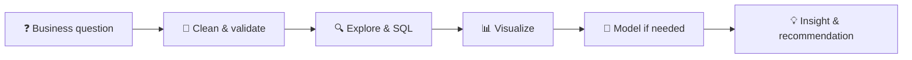

<p align="center">
  
</p>

<p align="center">
  <a href="https://github.com/shaikhanila"></a>
</p>

<p align="center">
  
  
  
  
  
</p>


### 🔎 `SELECT * FROM anila`

```sql
SELECT
    name        AS "Anila Shaikh",
    education   AS "MSc Mathematics, IIT Delhi",
    role        AS "Data Analyst",
    superpower  AS "Maths-backed thinking + clear storytelling",
    looking_for AS "Data / Business / BI Analyst roles"
FROM   me
WHERE  curiosity = 'high'
  AND  coffee    > 0;
```


### 🧪 How I work on a problem




### 📁 Case Files

| # | Case | The question | Toolkit | Link |
|---|------|--------------|---------|------|
| 01 | **Paisabazaar Dashboard** | What does the banking data look like at a glance? | Power BI · DAX | [Open](https://github.com/shaikhanila/powerbi_project) |
| 02 | **Banking Fraud Analysis** | Which patterns hint at fraud? | Python · Pandas · Seaborn | [Open](https://github.com/shaikhanila/EDA_Project) |
| 03 | **Bank Churn Prediction** | Which customers are likely to leave? | Python · ML | [Open](https://github.com/shaikhanila/bank-churn-prediction) |
| 04 | **Cohort & Retention (E-commerce)** | Do customers come back, and which products drive sales? | SQL · Python | [Open](https://github.com/shaikhanila/sql-cohort-retention-analysis) |

<details>
<summary><b>🏆 Key finding from each case (fill these in, recruiters love numbers)</b></summary>

- **01:** _e.g. "Top 3 segments drive 60% of revenue"_
- **02:** _e.g. "Fraud spikes in transactions above ₹X"_
- **03:** _e.g. "Model reaches XX% recall on churners"_
- **04:** _e.g. "Month-1 retention is XX%, dropping to YY% by month 3"_

</details>


### 🧰 Toolbox

<p align="center">
  
</p>

<p align="center">
  
</p>


### 📈 My GitHub Activity

<p align="center">
  
</p>


### 📡 Currently

```python
anila = {
    "learning":  ["Advanced SQL", "Machine Learning", "GenAI"],
    "building":  "more end-to-end analytics case studies",
    "reading":   "other analysts' dashboards for ideas",
    "open_to":   ["Full-time roles", "Collaboration", "Feedback on my projects"],
}
```

### 📬 Say hello

[](https://www.linkedin.com/in/anilashk5413)
[](mailto:shaikhanila2299@gmail.com)

<p align="center"><sub>If a project helped you, a ⭐ makes my day.</sub></p>


